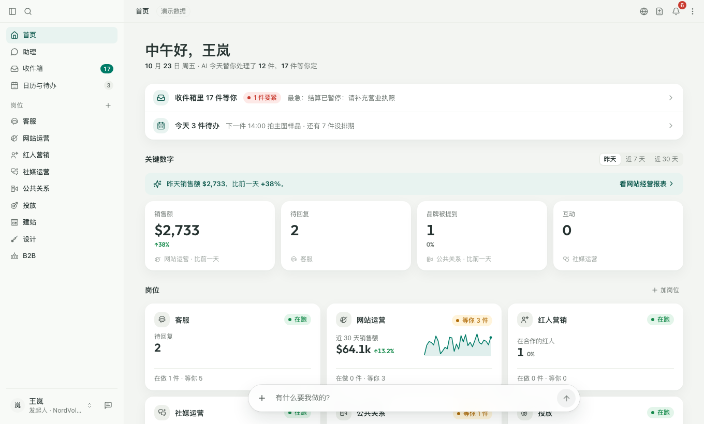
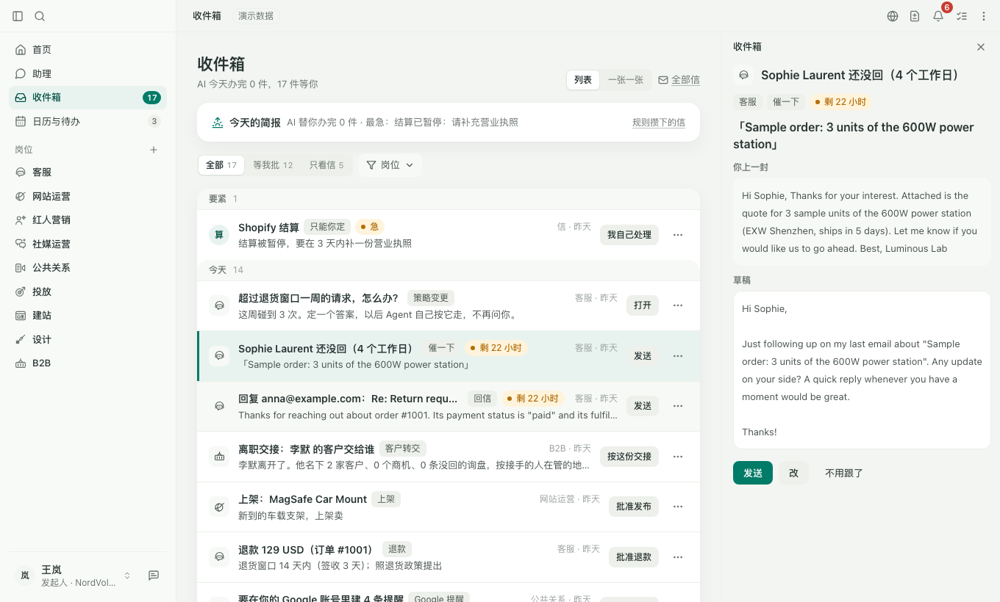
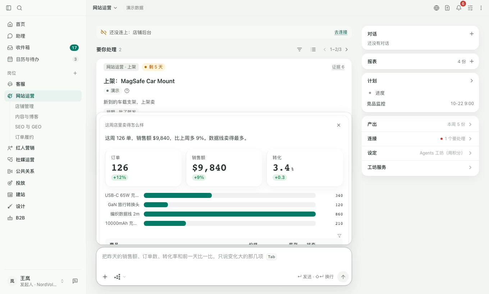

<p align="center">
  <picture>
    <source media="(prefers-color-scheme: dark)" srcset="docs/assets/brand/mark-idle-dark.svg">
    
  </picture>
</p>

<h1 align="center">Agents 工坊</h1>

<p align="center"><b>一支主动式 AI Agents 团队，自己找活干。</b></p>

<p align="center">
  专为跨境电商 / 出海卖家打造的 AI Agents。<br>
  客服、红人、Reddit、广告、建站、B2B 按岗位配齐。每天自己巡查、起草、跟进，要你拍板的才排进收件箱。
</p>

<p align="center">
  <a href="https://agentsws.com"><b>官网</b></a> ·
  <a href="https://agentsws.com/download/"><b>免费下载</b></a> ·
  <a href="https://agentsws.com/pricing/">价格</a> ·
  <a href="https://agentsws.com/docs/">教程</a> ·
  <a href="https://agentsws.com/changelog/">更新日志</a> ·
  <a href="README.en.md">English</a>
</p>

<p align="center">
  <a href="https://github.com/Luoye-W/agentsws/actions/workflows/ci.yml"></a>
  <a href="LICENSE"></a>
</p>

<p align="center">
  <picture>
    <source media="(prefers-color-scheme: dark)" srcset="apps/site/src/assets/app/home-dark.png">
    
  </picture>
</p>

开源 · Apache-2.0 · 跑在你自己的电脑上。Mac / Windows 双击就装，目前是内测版。

---

## 按岗位开工

缺几个人，就上几个岗位。每个岗位各管一摊，各有自己的记忆；要拍板的事，先出一张卡给你。

| 岗位 | 干什么 | 会出的卡 |
|---|---|---|
| 客服 | 邮件、网站聊天、Amazon 消息，先起草再给你发 | 回信 · 退款 / 补发 · 改地址 · 催一下 |
| 红人营销 | 找红人、打分、写建联信，跟到交付 | 建联信 · 报价与合作条款 · 内容审核 |
| 社媒运营 | 排内容、回评论；Reddit 收件箱和版块天天巡查 | 发帖 · 回评论 · Reddit 回帖（插件里填好，你点发送） |
| 网站运营 | 商品、促销、邮件；SEO 与 GEO 每周体检，盯着 AI 怎么回答你的品类 | 改价 / 促销 · 邮件营销群发 · 发货与履约 · 技术体检要改的 |
| Amazon 运营 | 只在你卖 Amazon 时出现：Listing 体检、关键词差距、盯竞品对标款 | 竞品监控方案 · 向设计岗提图片需求 |
| 投放 | Google / Meta 广告：盯花费、写新素材，改动先预览；另 6 个平台拖进导出的报表就能看 | 止损暂停 · 新标题与描述 · 上传表（预览后再提交） |
| 建站 | 在 Shopify 上搭页面、换主题，改前给你看 | 选主题 · 页面改动 · 上线检查 |
| B2B | 询盘分级，报价按授权走，跟到出货 | 首封回信 · 报价单（PDF） · 寄样通知 · 业务员交接 |
| 公共关系 | 新闻稿、论坛露出、全网提及与负面预警 | 媒体稿 · 论坛回帖 · 负面预警 |
| 设计 | 照你的品牌规范出图：网站、Amazon、社媒、广告 | 出图 · 广告素材批量出图 |

岗位不够用？在公司页自己建一个，名字也能改成你们公司的叫法。→ [每个岗位管什么](https://agentsws.com/roles/)

## 每天打开它

- **收件箱** — 所有岗位等你批的卡、只能你定的信，排成一条队。扫列表，或者一张一张过，按键盘就行。
- **日历与待办** — 一句话记待办；没排日子的，AI 按你的作息排进空档，你点「采用」才算。
- **首页** — 今天几件等你定、几件待办，昨天卖了多少，各岗位在干什么。

<p align="center">
  <picture>
    <source media="(prefers-color-scheme: dark)" srcset="apps/site/src/assets/app/inbox-dark.png">
    
  </picture>
</p>

## 接上 AI，用你已有的

- **DeepSeek 账号登录** — 用你自己的 DeepSeek 账号，按你账号里的余额扣。
- **ChatGPT 订阅** — 用你已经付了的 ChatGPT 订阅。
- **你自己的 API key** — DeepSeek、OpenAI、Anthropic、Google、百炼……直连，不经过我们。
- **工坊积分** — 和 DeepSeek 官方同价，不用去各家注册。

## 海外的内容，搜得到，也打得开

很多海外网站的内容，DeepSeek 自带的搜索检索不到，出海品牌要重点看的那些站尤其如此。所以工坊做了自己的一套：搜索走我们自己的数据接口，查得到 Google / Bing 的海外结果；要登录、要点按钮的页面，交给浏览器去开。

<details>
<summary><b>三种浏览器方案</b></summary>

- **自研浏览器插件** — Agents 工坊助手是我们自己的 Chrome 插件：Reddit 发帖、红人数据收集，用你已登录的账号。回帖在你开着的帖子里就地填好，发送你自己点。
- **腾讯开源 BrowserSkill** — 用你日常的 Chrome / Edge 做自动化操作。AI 在单独的窗口里操作，要动你已经开着的标签先问你；本机小程序版本和校验码都钉死。
- **适配 ego lite** — 专为 AI 自动化设计的浏览器；装了就能在设置里选它，运行记录里看得到每一段操作。

</details>

## 几句话交代，它自己配好

不用学后台，不用画流程。缺什么，它在对话里问你。

<details>
<summary><b>连接与设置</b> · 一键连上各平台 · 缺什么就地补 · 说一句配起来</summary>

- **一键连上各平台** — Shopify、Amazon、Google / Meta 广告、Reddit……借你浏览器里已登录的账号，或点一下授权。不用申请开发者应用，不开终端。
- **缺什么，就地补** — 少个连接、少个设置，对话里弹一张卡；补完接着做。
- **说一句，配起来** — 周报、记到你自己的表格，这类需求说给它听就行，不用等我们出新功能。

</details>

<details>
<summary><b>收信与回复</b> · 收信规则一句话建 · 没回的信它记着 · Reddit 回帖插件里填好</summary>

- **收信规则一句话建** — 「结算通知打标签、记到表里、别烦我」。先拿过去 30 天的信试一遍，你点「建」才生效。
- **没回的信，它记着** — 你发的信 3 个工作日没回，出一张「催一下」，草稿写好了；对方回了，卡自己撤掉。
- **Reddit 回帖在插件里填好** — 草稿进浏览器插件，在你开着的帖子里就地填入，发送你自己点。

</details>

<details>
<summary><b>日程</b> · AI 排空档 · 定时上班</summary>

- **AI 排空档** — 按你设的作息（上下班、周末、直播前后、午饭）排，你点「采用」才算；上周没做完的自动挪进本周。
- **定时上班** — 每天巡查、每周出报告，到点就干。

</details>

<details>
<summary><b>数据与搜索</b> · 回答就是图表 · SEO 与 GEO 技术体检 · AI 怎么说你的品类</summary>

- **回答就是图表** — 问数据，直接回数字卡、图和表；读不到的数照实写差哪个连接。
- **SEO 与 GEO 技术体检** — 每周一查收录、规范网址、死链、站点地图、hreflang、结构化数据、速度，要改的交给建站岗位。
- **AI 怎么说你的品类** — ChatGPT、Perplexity 提没提你，说错的名称、价格、卖点列成清单，改了到期复查。

<p align="center">
  <picture>
    <source media="(prefers-color-scheme: dark)" srcset="apps/site/src/assets/app/answer-dark.png">
    
  </picture>
</p>

</details>

<details>
<summary><b>省心</b> · 告警进铃铛 · 左下角反馈 · 办完留账</summary>

- **告警进铃铛** — 紧急的标红、排最上，点一下直达对应岗位。
- **左下角「反馈」** — 能附截图，没登录也能发，回复进铃铛。
- **办完留账** — 发出去的每一条都在本机留记录，谁批的都查得到。

</details>

## AI 只提议，点头的永远是你

要发出去、要花钱、要改东西的，一律先变成一张卡，进收件箱，带理由和出处。你选：发送、改一下，或不发。

退款、补发、改价、发布，永远人审。采纳率再高，也不自动放行。

## 你的生意，留在你的电脑上

- **双击就装** — Mac、Windows 都有，不用 Docker，不用命令行。
- **钥匙在你手里** — 店铺、邮箱的密码只在原生表单里填，存在本机加密库；不经 AI、不进日志。
- **上云你说了算** — 开了云端服务或跑长程任务才上云：只传需要的部分，能导出、能删。
- **模型断了就停** — AI 连不上时整条线冻结，不瞎发。

<details>
<summary>匿名使用记录发什么</summary>

用了哪个功能、点了哪个按钮，不带店铺、客户、订单的任何内容。测试期间默认开，设置 → 数据与隐私里一键关。

</details>

<details>
<summary>一个人用，团队用，整个公司也能用</summary>

- **个人（默认）** — 一个人管几个品牌，岗位都归你；要对外的事，你点头才算。
- **团队** — 同事互联，各管各的岗位，谁也不批谁；活能交给同事，对方接下才算。不在一个网络里的同事，开团队通道连上（按人数月付）。
- **整个公司** — 老板开启：一个余额，给每人设每月上限和能看的店铺，要紧的事按上下级审批。

从一个人用起，往上升级；数据跟着走，不用重装。

</details>

## 价格

开源版全功能免费。自带 DeepSeek 账号、ChatGPT 订阅或模型 key，直连各家，不经过我们，不扣积分。不想去各家注册，就用工坊积分：按量扣，和 DeepSeek 官方同价。跨网连同事的团队通道按人数月付，本机和同一局域网里互联不收费。→ [价格](https://agentsws.com/pricing/)

## 有问题

- 工作台左下角「反馈」：能附截图，我们的回复会出现在铃铛里。
- 或者在 GitHub 开 [issue](https://github.com/Luoye-W/agentsws/issues)。安全问题走 [`SECURITY.md`](SECURITY.md)，别开公开 issue。

## 基于 DeepSeek Harness

[DeepSeek Harness](https://github.com/deepseek-ai/deepseek-harness) 是底座，Agents 工坊是它的一个发行版：按官方的方式扩展，不改它的内核。官方出了新版先评估，测试和模拟回路全绿才升级。

---

## 开发者

### 从源码跑

需要 Node ≥ 22 和 pnpm ≥ 10（`corepack enable pnpm`）。下面这几步不用模型 key，也不用任何账号。

```bash
git clone https://github.com/Luoye-W/agentsws.git
cd agentsws
pnpm install
pnpm build

# 工作台 + 一家虚拟公司当后端，只听 127.0.0.1（端口被占时加 --port 4318）
pnpm dev:demo

# 模拟回路：让虚拟公司把场景跑一遍，六条底线全过才算过（CI 的合并门禁就是它）
pnpm simulate --tier fast --pack packs/dtc-3c-3p --scenario 'scenarios/**/*.yml' --seed 42

pnpm test
pnpm lint
```

只想用，不想碰代码：去[下载页](https://agentsws.com/download/)装桌面版就行。

### 仓库结构

| 目录 | 放什么 |
|---|---|
| `apps/` | 桌面壳、工作台、服务进程、命令行、浏览器插件、官网…… |
| `packages/` | 契约与它们的实现：审批、数据、岗位、知识、模型网关、各岗位的业务包…… |
| `role-packs/` · `skills/` | 职责包与共享技能 |
| `packs/` | 虚拟公司数据集，给模拟回路用 |
| `docs/help/` | 用户教程的源文件，官网「教程」直接读它 |

分层、契约、审批与安全模型见 [`docs/ARCHITECTURE.md`](docs/ARCHITECTURE.md)（英文）。

### 参与贡献

看 [`CONTRIBUTING.md`](CONTRIBUTING.md)。提交用 DCO（`git commit -s`），不用签 CLA。行为准则见 [`CODE_OF_CONDUCT.md`](CODE_OF_CONDUCT.md)。安全问题**不要开公开 issue**，走 [`SECURITY.md`](SECURITY.md) 的私密渠道。

### 许可证

代码以 **Apache-2.0** 发布（[`LICENSE`](LICENSE)、[`NOTICE`](NOTICE)）。名称与标志不在许可范围内，见 [`TRADEMARK.md`](TRADEMARK.md)：可以 fork，fork 请改名。
